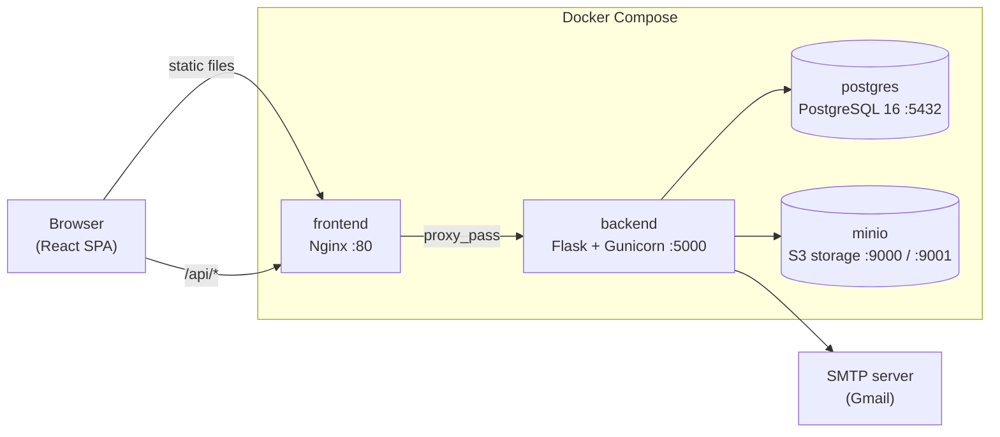
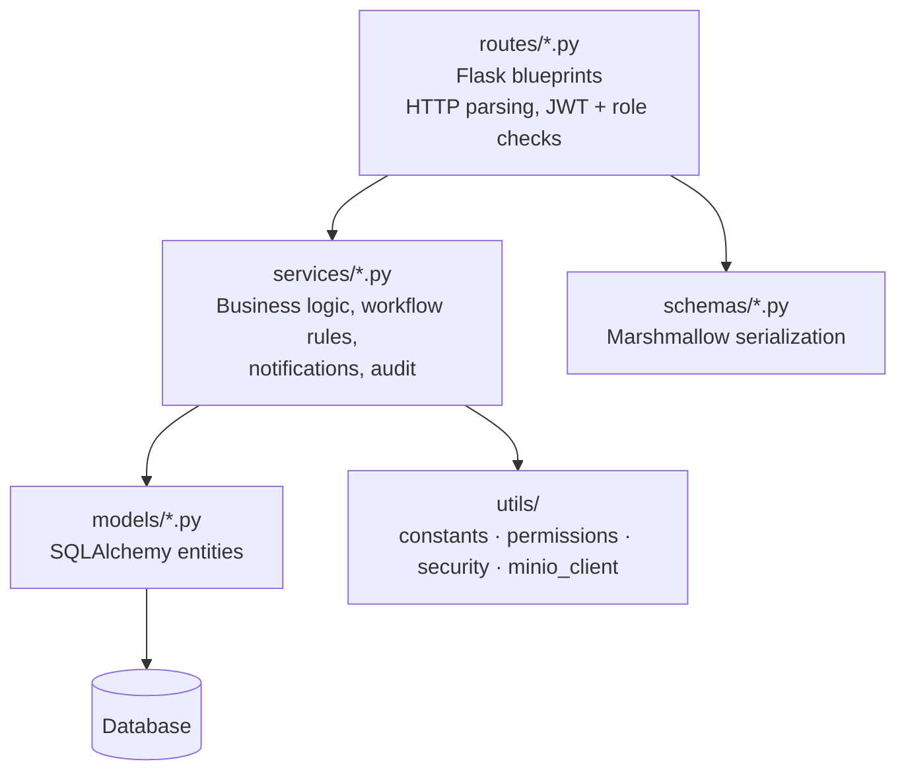

# Architecture

DiplomTrack is a classic **three-tier web application**: a React single-page app, a stateless Flask REST API, and a relational database. A separate object store holds files. In production every tier runs as a container under Docker Compose.

## Deployment view



| Container | Image / build | Role |
|---|---|---|
| `diplomtrack_frontend` | `frontend/Dockerfile` (Node 22 build stage, then `nginx:alpine`) | Serves `dist/` with SPA fallback (`try_files … /index.html`) and proxies `/api/` to `backend:5000` |
| `diplomtrack_backend` | `backend/Dockerfile` (`python:3.13.7-slim`) | Waits for Postgres, runs `init_db.py`, then starts Gunicorn |
| `diplomtrack_postgres` | `postgres:16` | Main database. Data is bind-mounted to `./postgres` |
| `diplomtrack_minio` | `minio/minio` | Object storage for profile images. Data is bind-mounted to `./minio` |

Because Nginx proxies `/api`, the browser sees a single origin in production (`VITE_REST_API_URL=/api`). In development the SPA runs on `:8080` and calls `http://localhost:5000/api` directly, so the backend enables CORS for `localhost:8080`, `localhost:3000` and `127.0.0.1:8080`.

## Backend

### Layering

The backend follows a **routes → services → models** layering:



| Layer | Folder | Responsibility |
|---|---|---|
| Entry point | `app.py`, `wsgi.py` | `create_app()` factory: loads `Config`, initializes extensions, CORS, global error handlers, starts the scheduler, registers blueprints |
| Extensions | `extensions.py` | Shared `db` (SQLAlchemy), `jwt` (JWTManager), `mail` (Flask-Mail) singletons |
| Routes | `routes/` | One blueprint per resource: `auth`, `admin`, `students`, `tickets`, `documents`, `notifications`, `emails`, and `data` (milestones, settings, profiles, formations, history) |
| Services | `services/` | `TicketService`, `DocumentService`, `workflow_service.update_status`, `StudentService`, `UserService`, `AuthService`, `NotificationService`, `EmailService`, `AuditService` |
| Schemas | `schemas/` | Marshmallow schemas that shape JSON responses |
| Models | `models/` | 14 SQLAlchemy entities (see [data-model.md](data-model.md)) |
| Background jobs | `tasks/scheduler.py` | APScheduler `BackgroundScheduler`. Runs `check_delay_warnings` every hour |
| Utilities | `utils/` | `constants.py` (workflow graph, document types), `permissions.py` (`@require_roles`), `security.py` (Werkzeug password hashing), `passwords.py`, `minio_client.py` |

Larger services are split into small helper classes, each with one concern. For example `workflow_service.py` has `WorkflowValidator`, `WorkflowNotifier`, `ChronologyManager` and `WorkflowManager`, and `ticket_service.py` has `TicketFormatter`, `TicketDocumentManager`, `StudentManager`, `DiplomaValidationManager` and `TicketQueryBuilder`. The public entry points are static methods on a facade class such as `TicketService` or `DocumentService`.

### The workflow engine

The heart of the system is `services/workflow_service.update_status()`. It is the only place a ticket's milestone changes. It runs in four phases:

1. **Validation.** It checks the correction workflow, the attestation workflow, the diploma-type restrictions, document completeness, and finally the transition graph `VALID_TRANSITIONS` in `utils/constants.py`.
2. **Transition.** It closes the current `Chronologie` row and creates or overwrites the row for the target milestone. It then updates `current_milestone_id` and `status`, and auto-switches `ATTESTATION` to `DIPLOMA` when the center's validation arrives.
3. **Notification.** It creates in-app `Notification` rows for the ticket owner based on the milestone.
4. **Commit.** It writes the audit entry and commits.

Document validation and invalidation in `DocumentService` can trigger transitions automatically, for example moving a ticket into or out of `ATTENTE_CORRECTION_DOCS`. The full rules are in [workflow.md](workflow.md).

### Authentication and authorization

- **JWT** via Flask-JWT-Extended. The token identity is the username. Extra claims are `role`, `user_id` and `must_reset_password`. Tokens expire after 8 hours.
- **RBAC** via the `@require_roles("ADMIN", "AGENT", …)` decorator in `utils/permissions.py`, which reads the `role` claim. It is stacked under `@jwt_required()`.
- **Ownership checks** for the `STUDENT` role happen inside route handlers. A student only sees tickets and documents tied to the `Student` row linked to their account.
- **Signup is restricted.** A user can sign up only if a `Student` profile with the same email already exists. The new account is then linked to that profile.
- **Forced password reset.** Accounts created by an admin, including the seeded admin, have `must_reset_password=True`. The frontend shows `ForcePasswordResetModal` until the password is changed.

### Cross-cutting concerns

| Concern | Implementation |
|---|---|
| Error handling | `exceptions.py` defines `APIException` and its subclasses (`ValidationError`, `AuthenticationError`, `AuthorizationError`, `NotFoundError`). Global handlers in `app.py` return `{error, code, status}`, plus a stack trace when `FLASK_ENV=development` |
| Audit trail | `AuditService.log_action()` writes an `audit_logs` row and appends to a per-route file in `backend/logs/` (for example `api_tickets_1_transition.log`) |
| In-app notifications | `NotificationService` stores `notifications` rows. The frontend polls them through `/api/notifications` |
| Email | `EmailService` renders HTML templates stored in `AppConfig` (seeded from `templates/emails/*.html`) and sends them through Flask-Mail |
| Scheduled jobs | APScheduler runs an hourly delay check for tickets waiting in `EN_ATTENTE_REPONSE` longer than `AppConfig.warning_delay_days` |
| Configuration | `config.py` reads environment variables. Business settings (delays, upload size, templates) live in the single-row `app_config` table and can be edited in the UI |
| File storage | When `USE_MINIO=true`, profile images go to the MinIO bucket `uploads`. Otherwise they go to `uploads/profiles/`. Documents store only a `file_path` reference |

## Frontend

The frontend is a React 18 + TypeScript SPA built with Vite. It was scaffolded with **Lovable**, which explains `lovable-tagger`, the shadcn/ui component set and the Supabase leftovers.

```
src/
├── pages/            One component per route (dashboards, tickets, students, settings…)
├── components/
│   ├── ui/           shadcn/ui primitives (Radix + Tailwind)
│   ├── layout/       DashboardLayout, AppSidebar, NotificationsMenu
│   ├── tickets/      TicketCard, WorkflowTimeline, TicketImportDialog
│   ├── students/     StudentForm, ImportStudentsDialog
│   └── …             admin/, documents/, dashboard/, common/
├── hooks/
│   ├── api/          TanStack Query hooks per resource (useTicketsQuery, useStudents…)
│   └── AuthProvider  Auth context, current user, role
├── lib/api/          API abstraction layer (see below)
├── constants/        UserRole enum
└── types/            Shared TypeScript types
```

### API abstraction (adapter pattern)

`src/lib/api/` defines an `IApiClient` interface (`interfaces.ts`) with two adapters:

- `rest.adapter.ts` talks to the Flask backend. This is the adapter in use (`VITE_API_BACKEND="rest"`). It stores the JWT in `localStorage` and sends it as `Authorization: Bearer …`.
- `supabase.adapter.ts` is the original Lovable/Supabase backend. It is kept but inactive, along with `src/integrations/supabase/` and `frontend/supabase/migrations/`.

`index.ts` is a factory and singleton that picks the adapter from `VITE_API_BACKEND`. Pages never call `fetch` directly. They go through TanStack Query hooks in `hooks/api/`, which call `api.*`.

### Routing and access control

`App.tsx` declares the routes. `ProtectedRoute` wraps each page with `allowedRoles`, and `RootRedirect` sends `/` to the right home page for the role:

| Path | Roles | Page |
|---|---|---|
| `/auth` | public | Login / signup |
| `/admin` | ADMIN | Admin dashboard |
| `/agent` | AGENT | Agent dashboard |
| `/dossiers` | AGENT, ADMIN | Ticket list |
| `/dossiers/create`, `/dossiers/create-advanced` | AGENT | Create ticket (simple / with history) |
| `/dossier/:id` | any authenticated | Ticket detail with workflow timeline |
| `/students` | AGENT, ADMIN | Student management and Excel import |
| `/agent-notifications` | AGENT, ADMIN | Notifications |
| `/my-dossier`, `/notifications` | STUDENT | Student's own dossier and notifications |
| `/users`, `/settings` | ADMIN | User management, app settings and email templates |
| `/profile` | all | Profile and avatar |

## Key design decisions

- **Explicit state machine.** Workflow rules live in one transition graph (`VALID_TRANSITIONS`) plus validator methods, rather than being spread across routes.
- **Chronology table.** Every milestone visit is a `Chronologie` row with start and end timestamps. This feeds the timeline UI and delay detection, and lets "advanced" ticket creation backfill historical dates.
- **Database portability.** `DATABASE_TYPE=sqlite` gives a no-dependency local setup. Docker uses PostgreSQL. Tables are created with `db.create_all()` on startup. Alembic and Flask-Migrate are installed but no migrations exist.
- **Swappable frontend backend.** The adapter layer allowed the move from Supabase to the Flask API without rewriting pages.
