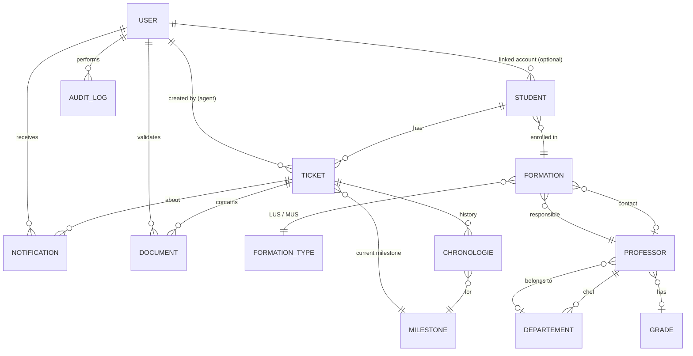

# Data model

All entities are SQLAlchemy models in `backend/models/`. Tables are created with `db.create_all()` when the app starts and by `init_db.py`. There are no migrations.

## Entity-relationship diagram

`APP_CONFIG` is a standalone single-row table.

## Tables

### `users`
Login accounts for every role.

| Column | Notes |
|---|---|
| `username`, `email` | Unique |
| `password_hash` | Werkzeug hash |
| `role` | `STUDENT` \| `AGENT` \| `ADMIN` |
| `is_active` | Disabled accounts cannot log in |
| `must_reset_password` | Forces a password change at next login |
| `profile_image` | MinIO object key or local path |

### `students`
Student profiles. A profile can exist **without** an account. `user_id` is filled in when the student signs up with the same email.

| Column | Notes |
|---|---|
| `user_id` | FK → `users`, nullable, `ON DELETE SET NULL` |
| `first_name`, `last_name`, `email` | `email` is indexed and used for signup linking |
| `num_apogee` | Unique student number (Apogée), nullable |
| `academic_year` | e.g. `2024-2025` |
| `formation_id` | FK → `formations` |

### `tickets`
One diploma dossier.

| Column | Notes |
|---|---|
| `reference` | Unique, `FC-XXXXXXXX` |
| `student_id` | FK → `students`, cascade delete |
| `user_id` | FK → `users`: the agent who created it, and the recipient of workflow notifications |
| `current_milestone_id` | FK → `milestones` |
| `status` | `OPEN`, `PENDING`, `COMPLETED` (as set by the workflow; see known issues) |
| `diploma_validation_type` | `DIPLOMA` \| `ATTESTATION` |

### `documents`
One required document of a ticket.

| Column | Notes |
|---|---|
| `ticket_id` | FK → `tickets`, cascade delete |
| `document_type` | See the document table in [workflow.md](workflow.md#documents) |
| `file_path` | Reference to the file. No binary upload goes through this API |
| `is_validated`, `validation_comment`, `validated_by`, `validated_at` | Validation state |

### `milestones`
Workflow steps: `code` (unique), `label`, `order`, `is_terminal`. Seeded, not user-editable.

### `chronologies`
Timeline of a ticket. Each ticket has at most one row per milestone, because revisiting a milestone overwrites its row.

| Column | Notes |
|---|---|
| `ticket_id`, `milestone_id` | FKs |
| `status` | `PENDING` (active) \| `DONE` \| `BLOCKED` |
| `started_at`, `ended_at`, `completed_at` | Timing, used by the UI timeline |
| `performed_by`, `comment`, `blocked_reason` | Context |

### `notifications`
In-app messages: `user_id`, optional `ticket_id`, `type` (`info` \| `warning` \| `error` \| `success`), `title`, `message`, `is_read`.

### `audit_logs`
`performed_by`, `action` (e.g. `SIGNUP`, `MILESTONE_UPDATE`, `CREATE_ADMIN`), `entity_type`, `entity_id`, `description`, `route`, `ip_address`, `created_at`.

### `app_config`
Single row (`id=1`) of business settings, editable from **Admin → Settings**:

- `warning_delay_days` (14), `alerts_email`, `max_upload_size_mb`, `auto_archive_days`
- Email subject and HTML body for the three templates: ticket blocked, agent delay warning, admin daily report
- `enable_email_notifications`, `email_check_interval_hours`
- Legacy text templates `notification_template_student` / `notification_template_agent`

### Academic reference data

| Table | Contents |
|---|---|
| `formation_types` | `LUS` (Licence Universitaire Spécialisée), `MUS` (Master Universitaire Spécialisé) |
| `formations` | Programs. Unique on (`formation_name`, `formation_type_id`). Have a responsible professor and an optional contact professor |
| `professors` | Name, email, phone, speciality, department, grade |
| `departements` | Unique name, with a chef professor. Unassigned professors default to "Enseignements Généraux" |
| `grades` | Academic ranks (name, code) |

All of these are seeded by `init_db.py`: `seed_departements`, `seed_grades`, `seed_formation_types` and `seed_formations`.
