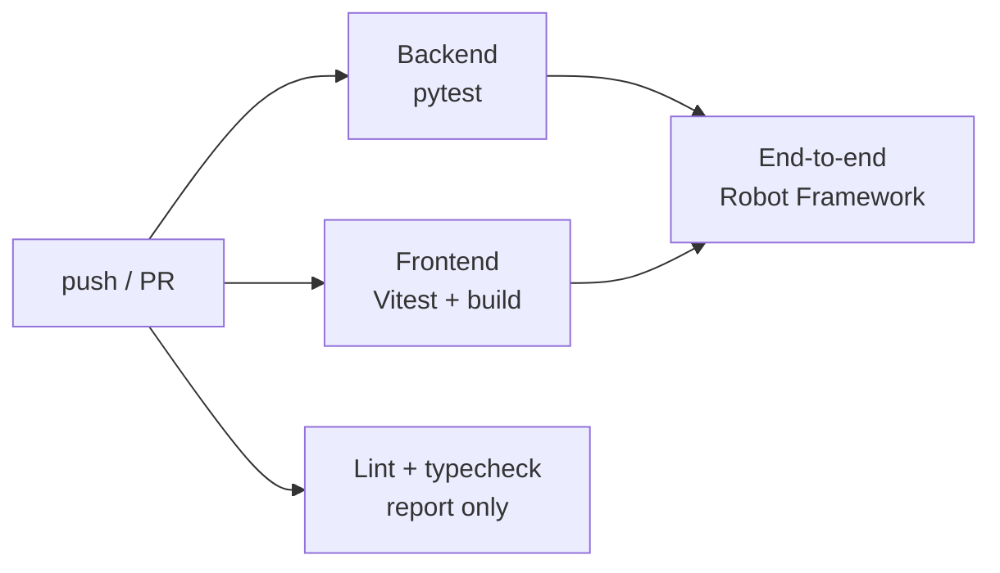

# Testing

DiplomTrack has three test layers. Run the first two on every change; run the QA suite before a release or when you touch login, routing or role checks.

| Layer | Tool | Where | What it proves | Needs |
|---|---|---|---|---|
| Backend | pytest, pytest-cov | `backend/tests/` | Routes, services and the workflow engine against a seeded SQLite database | Python |
| Frontend unit + integration | Vitest, Testing Library, MSW | `frontend/src/**/*.test.ts(x)` | The API client, hooks and components against a fake Flask API | Node |
| End-to-end QA | Robot Framework + SeleniumLibrary | `frontend/qa/` | Real browser, real Flask API, real database | Python, Node, a browser |

## Backend (pytest)

```sh
cd backend
pytest                                   # ~10 s
pytest --cov --cov-report=term-missing   # with coverage of application code (.coveragerc)
pytest tests/test_ticket_lifecycle.py -k attestation   # one area while you work
```

| File | Covers |
|---|---|
| `test_ticket_lifecycle.py` | The workflow engine through the API: creation, the main path to closure, the correction loop, the attestation path, guard rules (400), who sees and moves which ticket, student notifications |
| `test_students_api.py` | Student CRUD, bulk creation, filters, paging, per-role access |
| `test_users_api.py` | Login, session, signup, password change, profile image, admin user management, bulk agents |
| `test_documents_api.py` | Upload, validate/invalidate, status, missing documents, 404s, permissions |
| `test_data_api.py` | Milestones, formations, profiles (ownership), user roles, history, app settings, email test |
| `test_api_contract.py` | HTTP rules the SPA relies on: no trailing-slash redirects, 401 for every token problem |
| `test_app_factory.py` | `create_app()` wiring: blueprints, JSON 404, CORS preflight |
| `test_admin_users.py`, `test_auth_routes.py`, `test_notification_routes.py` | Focused route tests |
| `test_delay_warnings.py`, `test_scheduler_lock.py`, `test_email_notifications.py`, `test_secure_defaults.py` | Background jobs, emails and configuration |

Most API tests use the `seeded` fixture (`tests/conftest.py`, helpers in `tests/helpers.py`). It builds the app with every blueprint and the production error handlers, starts from a copy of a database seeded once per session with the same reference data as `init_db.py` (milestones, formations…), and creates one account per role:

```python
def test_agent_moves_a_dossier(seeded):
    tid = seeded.create_ticket()["id"]                      # student + ticket through the API
    assert seeded.transition(tid, "DOSSIER_EN_COURS").status_code == 200
    seeded.attach_all_documents(tid)                        # files + validation for every required document
    assert seeded.get("/api/tickets", as_="student").status_code == 200   # as_= admin | agent | student
```

## Frontend unit and integration tests (Vitest)

```sh
cd frontend
npm test                 # run once
npm run test:watch       # re-run on change
npm run test:coverage    # text summary + coverage/index.html
```

### Layout

| Path | Kind | Covers |
|---|---|---|
| `src/lib/api/http.test.ts` | unit | URL joining, query strings in the `filter[field][eq]` format, JWT header, JSON vs multipart bodies, Flask error bodies (`error`, `message`, `msg`), 204, network errors, the 401 → `SESSION_EXPIRED` rule |
| `src/lib/api/adapters/rest.adapter.test.ts` | unit | CRUD helpers (`getMany` with plain arrays and `{data, count}`), `signIn` → `/session`, rejected tokens, `resetPassword`'s `{data, error}`, profile image upload |
| `src/components/routing.test.tsx` | component | `RootRedirect` and `ProtectedRoute` for each role, loading state and forced password reset |
| `src/constants/roles.test.ts` | unit | Role values match the backend's validation |
| `src/test/integration/auth.integration.test.tsx` | integration | The real login page, `AuthProvider` and router: login per role, wrong password, form validation, session restore, expired JWT logs out |
| `src/test/integration/lists.integration.test.tsx` | integration | List envelopes (`{tickets, total}`, `{students, total}`) as the hooks and the agent dashboard read them, including the empty state |
| `src/test/integration/hooks.integration.test.tsx` | integration | Every data hook's requests (method, path, body) against handlers that mirror the Flask routes: documents, milestones and history, settings, profiles (PUT), students, tickets, bulk agents, formations |
| `src/test/integration/pages.integration.test.tsx` | integration | `TicketDetail` (milestone select, refused transition, document validation), `MyDossier`, `CreateTicket`, `NotFound` |
| `src/test/integration/morePages.integration.test.tsx` | integration | `AdminDashboard`, `AdminSettings`, both notification pages, `AgentStudents`, `Profile` (failed and successful password change) |
| `src/test/integration/adminUsers.integration.test.tsx` | integration | User list, role badges, promoting a student through the role dialog |
| `src/App.test.tsx` | integration | The real route table: login page, anonymous redirect, role home page, 404 |
| `src/lib/api/pagination.test.ts`, `src/lib/tickets.test.ts`, `src/data/formations.test.ts` | unit | Helpers |
| `src/test/integration/notifications.integration.test.tsx` | integration | `useNotificationsQuery` and `NotificationsMenu` against the notification routes: unread count from `is_read`, `PATCH /<id>/read`, `/read-all`, link to `/dossier/<id>` |

### How the fake API works

`src/test/server.ts` starts an [MSW](https://mswjs.io) server that answers at `http://api.test/api` (the `VITE_API_URL` set in `vitest.config.ts`). It knows three accounts (`users.admin`, `users.agent`, `users.student`, password `PASSWORD`) and implements `/auth/login` and `/auth/session`. Each test adds the routes it needs:

```ts
server.use(http.get(`${API}/tickets`, () => HttpResponse.json([ticket])));
localStorage.setItem('auth_token', tokenFor(users.agent)); // start signed in
```

Unhandled requests fail the test (`onUnhandledRequest: 'error'`), so a hook calling the wrong URL cannot pass silently. Mirror the real response shape from `backend/routes/` when you add a handler: these tests are only as accurate as the fake.

`src/test/utils.tsx` has the render helpers:
- `renderWithProviders(ui, { path, initialPath, routes, auth })` renders inside a router (`path` is the route pattern such as `/dossier/:id`, `initialPath` the URL such as `/dossier/5`), a fresh QueryClient and either the real `AuthProvider` or a `fakeAuth()` context. Any other path renders a `data-testid="location"` probe, so redirects can be asserted.
- `queryWrapper()` is for `renderHook`.

One jsdom limit: Node's `fetch` cannot serialize jsdom's `FormData`, so multipart uploads are tested by stubbing `fetch` (see the upload test) rather than through MSW.

## End-to-end QA (Robot Framework)

### Setup (once)

```sh
pip install -r backend/requirements.txt -r frontend/qa/requirements.txt
cd frontend && npm ci
```

You also need Chrome, Edge or Firefox. Selenium Manager downloads the matching driver on the first run (internet access needed once).

### Run

```sh
python frontend/qa/run_qa.py                       # headless Chrome
python frontend/qa/run_qa.py --browser edge        # or firefox
python frontend/qa/run_qa.py --headed              # watch it
python frontend/qa/run_qa.py --include smoke       # any extra option goes to robot
```

`npm run qa` (from `frontend/`) runs the same script. Reports go to `frontend/qa/results/report.html` and `log.html`, with a screenshot of every failure.

`run_qa.py` builds a throwaway stack, so it never touches your dev database or dev servers:
1. Creates a temp SQLite database and runs `init_db.py` with a known admin password.
2. Starts Flask on port 5055 (scheduler off) and the Vite dev server on port 8095, proxying `/api` to it.
3. Runs `robot`, then stops both servers and deletes the database.

The servers' output goes to `frontend/qa/results/backend.log` and `frontend.log`, not the console. Read `backend.log` after a run: a passing suite can still hide redirects, 4xx/5xx answers or warnings (that is how the issues in [known-issues.md](known-issues.md#11--fixed-problems-found-by-the-qa-runs-server-log) were found). If port 5055 or 8095 is already taken, for example by a second run, the script stops instead of testing the other server; use `--api-port`/`--web-port` to run side by side.

To test a stack that is already running (for example `docker compose up` on a fresh database), pass `--base-url http://localhost --api-url http://localhost/api`, plus a matching `--variable ADMIN_PASSWORD:...` when `ADMIN_PASSWORD` is not `QaAdmin-2026!`.

### Suites

| File | Tags | Checks |
|---|---|---|
| `tests/__init__.robot` | | Seeds accounts through the API: activates the admin, creates an agent, a first-login agent and a student |
| `01_authentication.robot` | `auth`, `smoke` | Login page, backend error for a wrong password, client-side validation, login/logout, session after reload, tampered token |
| `02_first_login.robot` | `first-login` | An admin-created agent must change their password; the new one works and the old one doesn't |
| `03_access_control.robot` | `access-control`, `smoke`, `lists` | Anonymous redirects, each role's home page, students and agents kept out of pages they can't use, a record created through the API shows up in the agent's list, 404 page |
| `04_admin_and_notifications.robot` | `admin`, `notifications` | Admin user list with role badges, user search, promoting a student to agent, notification menu |
| `05_ticket_lifecycle.robot` | `lifecycle` | One dossier end to end: the agent creates it, starts processing, is refused completion while documents lack files, validates the scanned documents, moves it to closure; it shows as closed in the list; the student sees it closed and gets the "Dossier complet" notification |

Keywords live in `qa/resources/`: `app.resource` (browser actions such as `Log In As`, `Change Milestone To`, `Validate Every Pending Document`), `api.resource` (seeding, and `Attach Scanned Documents Through API` because the SPA has no file upload for dossier documents yet), `variables.resource` (URLs, accounts, timeouts). SeleniumLibrary runs with a 5-second implicit wait, so element lookups wait for the SPA to render. The first-login suite consumes the first-login state, so the suite expects a fresh database each run; `run_qa.py` provides one.

### Writing a new QA test

- Prefer element ids, roles and visible French labels (`id:login-email`, `button[aria-label="Notifications"]`) over CSS classes, which change with styling.
- Wait for outcomes (`Location Should Eventually Be`, `Wait Until Page Contains`) instead of sleeping.
- Create the data a test needs through the API in `api.resource`, not through the UI of another feature.

## Coverage

Line coverage on 2026-11-01 (application code only):

| Layer | Tests | Coverage | Lowest |
|---|---|---|---|
| Backend | 127 | 80 % | `ticket_service.py`, `email_service.py`, `document_routes.py` |
| Frontend | 121 | 72 % (shadcn/ui primitives excluded) | `StudentForm`, `EmailTemplateEditor`, `CreateAdvancedTicket` |
| QA (Robot) | 27 | every role's main journeys, including a dossier's whole lifecycle | |

Coverage is a map of what nothing exercises, not a goal: prefer a test that pins down a behaviour (like the lifecycle tests) over one written to light up lines.

## Continuous integration

`.github/workflows/tests.yml` runs on every push to any branch, on pull requests, and on demand (**Actions → Tests → Run workflow**). A newer push to the same branch cancels the run in progress.



| Job | Blocks the PR | Runs | Artifacts |
|---|---|---|---|
| Backend | yes | `pytest --cov`, failures annotated on the changed lines | `backend-test-results` (JUnit + `coverage.xml`) |
| Frontend | yes | `npm run test:coverage`, then `npm run build` | `frontend-test-results` (JUnit + coverage HTML) |
| Lint and typecheck | no | `npm run lint`, `npm run typecheck` | |
| End-to-end | yes | `python frontend/qa/run_qa.py --browser chrome`, only after the two test jobs pass | `robot-reports` (report, log, failure screenshots) |

Lint and typecheck are report-only because the frontend still carries older errors (see [known-issues.md](known-issues.md)). Once they are fixed, remove `continue-on-error: true` from the `static-checks` job so they block too.

To make the checks required, go to **Settings → Branches → Branch protection rule** for `main` and require the `Backend (pytest)`, `Frontend (Vitest)` and `End-to-end QA (Robot Framework)` status checks.

## Test-driven workflow

Write the test first, watch it fail for the right reason, then write the least code that makes it pass, then clean up with the tests green.

1. **Red.** Add a failing test at the lowest layer that can show the behaviour:
   - a rule in a service or route → `backend/tests/test_<feature>.py`
   - a request, response shape or hook → `frontend/src/**/<name>.test.ts`, faking the endpoint with `server.use(...)`
   - a whole user journey → a Robot test case, only when the lower layers can't show it
2. Run just that test while you work:
   ```sh
   pytest tests/test_admin_users.py -k create          # backend
   npx vitest src/lib/api/http.test.ts                 # frontend, re-runs on save
   python frontend/qa/run_qa.py --test "Agent Can Log In And Out"
   ```
   Check that it fails with the message you expect, not with an import error or a typo.
3. **Green.** Change the code until it passes. Run the whole layer (`pytest`, `npm test`) before pushing.
4. **Refactor** with the suite green, then push. CI runs the full pipeline on the branch, and the PR shows the result.

When you fix a bug, start by writing the test that reproduces it. Examples in this repo: `tests/test_admin_users.py` (the 500 on user creation) and the `is_read` tests in `notifications.integration.test.tsx`.

Pushing a red test on its own is fine on a feature branch: the run shows the failure, and the next push with the fix shows it pass. Don't merge a red pipeline.
