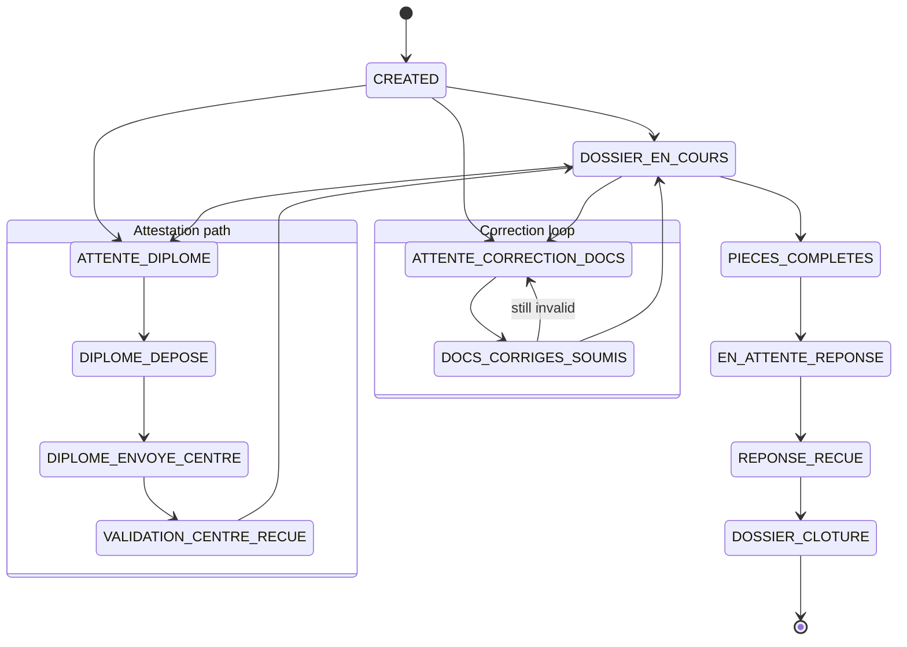

# Ticket workflow

A **ticket** (*dossier*) represents one student's diploma request. It always sits on exactly one **milestone**. Agents move it forward with `PATCH /api/tickets/<id>/transition`, and some transitions happen automatically when documents are validated or invalidated.

The rules live in:

- `backend/utils/constants.py`: the `VALID_TRANSITIONS` graph, document types and the auto-validated list
- `backend/services/workflow_service.py`: `update_status()` and its validators
- `backend/services/document_service.py`: document-triggered transitions
- `backend/services/ticket_service.py`: ticket creation, import and diploma-type changes

## Milestones

Seeded by `init_db.seed_milestones()` in this order:

| # | Code | Meaning |
|---|---|---|
| 1 | `CREATED` | Ticket opened |
| 2 | `ATTENTE_CORRECTION_DOCS` | Waiting for the student to correct invalid documents |
| 3 | `DOCS_CORRIGES_SOUMIS` | Corrected documents submitted, awaiting re-check |
| 4 | `ATTENTE_DIPLOME` | Student holds only an attestation; waiting for the actual diploma |
| 5 | `DIPLOME_DEPOSE` | Diploma deposited |
| 6 | `DIPLOME_ENVOYE_CENTRE` | Diploma sent to the university center for validation |
| 7 | `VALIDATION_CENTRE_RECUE` | Center validation received |
| 8 | `DOSSIER_EN_COURS` | Dossier being processed |
| 9 | `PIECES_COMPLETES` | All required documents validated |
| 10 | `EN_ATTENTE_REPONSE` | Submitted, waiting for an answer |
| 11 | `REPONSE_RECUE` | Answer received |
| 12 | `DOSSIER_CLOTURE` | Closed (terminal) |

## Transition graph

## Guard rules

`update_status()` runs these checks **before** the graph check. Any failure raises `ValueError`, and the API returns HTTP 400.

| Rule | Condition | Effect |
|---|---|---|
| Correction first | Current milestone is `CREATED` or `DOSSIER_EN_COURS` and an auto-validated document is invalidated | Only `ATTENTE_CORRECTION_DOCS` is allowed |
| Attestation must detour | `diploma_validation_type = ATTESTATION` and current milestone is `CREATED` | Cannot go straight to `DOSSIER_EN_COURS` |
| Diploma skips detour | `diploma_validation_type = DIPLOMA` | Cannot enter any attestation milestone (`ATTENTE_DIPLOME` … `VALIDATION_CENTRE_RECUE`) |
| Completeness | `DOSSIER_EN_COURS` → `PIECES_COMPLETES` | Every required document must be validated and have a `file_path` |
| Graph | Always | `next` must be in `VALID_TRANSITIONS[current]` |

## Side effects of a transition

1. The open `Chronologie` row is closed (`status=DONE`, `ended_at` set).
2. A `Chronologie` row for the target milestone is created. If the ticket visited this milestone before, the existing row is **overwritten** (reset to `PENDING`).
3. `ticket.status` becomes `COMPLETED` for `DOSSIER_CLOTURE`, `OPEN` for `CREATED`, and `PENDING` otherwise.
4. Reaching `VALIDATION_CENTRE_RECUE` with type `ATTESTATION` switches the type to `DIPLOMA` automatically.
5. A notification is sent to the ticket's `user_id` for these milestones: `ATTENTE_DIPLOME`, `DIPLOME_DEPOSE`, `DIPLOME_ENVOYE_CENTRE`, `VALIDATION_CENTRE_RECUE`, `PIECES_COMPLETES`, `DOCS_CORRIGES_SOUMIS`, and `ATTENTE_CORRECTION_DOCS` (which lists the invalid documents).
6. `PIECES_COMPLETES` writes an audit entry.

## Diploma validation type

Every ticket has a `diploma_validation_type`:

- **`DIPLOMA`** (the default): the student already holds the prior diploma, so the dossier goes straight to processing.
- **`ATTESTATION`**: the student holds only a provisional attestation. The dossier must go through the attestation path until the university center validates the real diploma.

Agents can change the type with `PATCH /api/tickets/<id>/diploma-validation-type`. `DiplomaValidationManager` then moves the ticket to the matching milestone.

## Documents

Each ticket gets one `Document` row per required type when it is created.

| Code | Label | LUS | MUS | Auto-validated at creation |
|---|---|:-:|:-:|:-:|
| `BAC` | Baccalauréat | ✓ | ✓ | ✓ |
| `CIN` | Carte d'Identité Nationale | ✓ | ✓ | ✓ |
| `CONTRAT` | Contrat | ✓ | ✓ | ✓ |
| `RECU_PAIEMENT` | Reçu de paiement | ✓ | ✓ | ✓ |
| `ATTESTATION_INSC` | Attestation d'inscription | ✓ | ✓ | ✓ |
| `BAC+2` | Diplôme Bac+2 | ✓ | | ✓ |
| `BAC+3` | Diplôme Bac+3 | | ✓ | ✓ |
| `RETOUR_CFC` | Retour CFC | ✓ | ✓ | |
| `PV_DIPLOME` | PV de diplôme | ✓ | ✓ | |

Auto-validated documents are documents collected at enrolment, so they start out validated. An agent can still **invalidate** one, which pushes the ticket into the correction loop.

Document-triggered transitions (`DocumentWorkflowHandler`):

- **Invalidating** a previously validated auto-validated document while the ticket is on `CREATED` or `DOSSIER_EN_COURS` moves it to `ATTENTE_CORRECTION_DOCS`.
- **Validating** a document while the ticket is on `DOCS_CORRIGES_SOUMIS`, when no invalid documents remain, moves it to `DOSSIER_EN_COURS`. If the type is `ATTESTATION`, it moves to `ATTENTE_DIPLOME` instead.
- The student or agent reports corrections with `POST /api/tickets/<id>/submit-corrected-documents`, which moves the ticket to `DOCS_CORRIGES_SOUMIS`.

## Creating tickets

| Method | Endpoint | Use |
|---|---|---|
| Simple | `POST /api/tickets/` | New ticket for an existing student on an initial milestone |
| Advanced | `POST /api/tickets/create-advanced` | Backfill a dossier already in progress: give the target milestone plus a list of past chronology entries with dates |
| Import | `POST /api/tickets/import` | Bulk import from Excel (parsed in the browser with `xlsx`). Creates or updates students, documents and chronologies per row |

References are generated as `FC-` followed by 8 uppercase hex characters.

## Delay warnings

Every hour, `tasks/scheduler.check_delay_warnings` calls `NotificationService.check_and_create_delay_warnings()`. The intent is to warn when a ticket has been in `EN_ATTENTE_REPONSE` longer than `AppConfig.warning_delay_days` (14 by default). An admin can also trigger the check by hand with `POST /api/notifications/check-delays`.

> As currently written, this check never matches any ticket. See [known-issues.md](known-issues.md#1-delay-warnings-never-fire).
